  

  

  <a href="https://www.linkedin.com/in/rohit-k-mishra/">LINKEDIN</a>
  &nbsp; / &nbsp;
  <a href="https://www.youtube.com/@Rohitharyamishra">YOUTUBE</a>
  &nbsp; / &nbsp;
  <a href="https://instagram.com/rohith.stoic">INSTAGRAM</a>
  &nbsp; / &nbsp;
  <a href="mailto:rohitkumarmishra8405@gmail.com">CONTACT</a>

------------------------------------------------------------------------

<table>
<tr>
<td width="58%" valign="top">

### 01 / PROFILE

I'm Rohit, a Data Science student at **IIT Madras**. I work on software, data-driven systems, and early-stage product ideas.

I like the full process: understanding a problem, designing a system, building the first version, testing it, and improving what doesn't work.

**Current direction:** software engineering, applied machine learning, backend systems, and product development.

</td>
<td width="42%" valign="top">

### SYSTEM / STATUS

| FIELD     | VALUE                   |
|:----------|:------------------------|
| Base      | Chennai, India          |
| Education | IIT Madras              |
| Focus     | Building products       |
| Languages | Python · SQL · JS       |
| Mode      | Learn / Build / Iterate |

</td>
</tr>
</table>

## 02 / PROJECT ARCHIVE

<table>
<tr>
<td width="33%" valign="top">

**01 — ZYRA**

`B2B SOFTWARE`

Lead generation and outreach workflows, bringing research and personalized communication into one product.

</td>
<td width="33%" valign="top">

**02 — MEAN AI**

`CONVERSATIONAL SYSTEMS`

Voice ingestion, transcription, conversation analysis, and commitment tracking.

</td>
<td width="33%" valign="top">

**03 — ECHO AI**

`EXPERIMENTAL`

A future-self simulation concept exploring skills, goals, personal data, and possible scenarios.

</td>
</tr>
</table>

  Selected work · Project scope and implementation may evolve. Explore the repositories for current details.

## 03 / TOOLCHAIN

  

  <code>Python</code> &nbsp; <code>SQL</code> &nbsp; <code>JavaScript</code> &nbsp;
  <code>Pandas</code> &nbsp; <code>NumPy</code> &nbsp; <code>scikit-learn</code>

## 04 / ACTIVITY MONITOR

  

  
  

------------------------------------------------------------------------

  ROHIT.OS · Personal workspace · Built with curiosity and code

